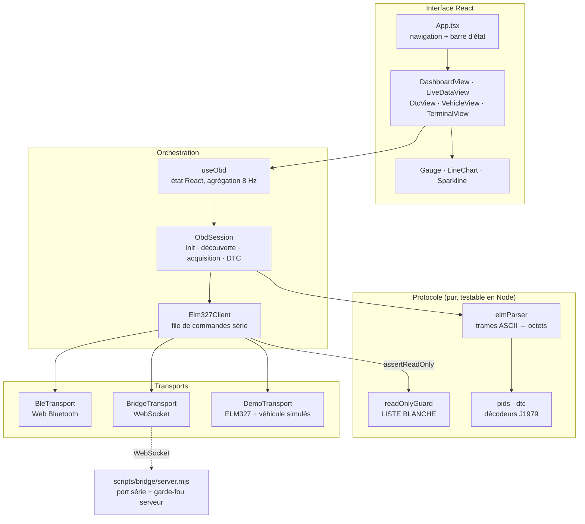
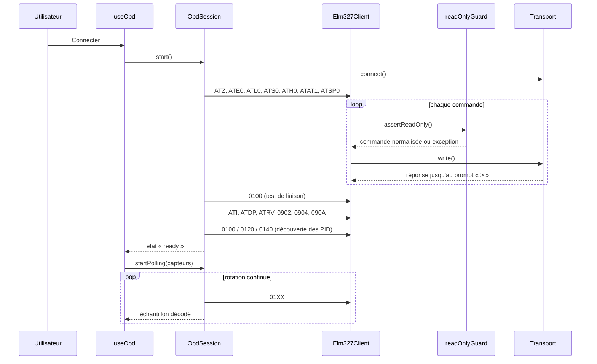

# Architecture

## Vue d'ensemble



## Principes structurants

### 1. Le garde-fou est un passage obligé

`Elm327Client.send()` est la **seule** méthode qui écrit sur un transport, et sa première
instruction est `assertReadOnly()`. Aucun autre module n'appelle `transport.write()`.
C'est ce qui rend la garantie de lecture seule vérifiable par simple lecture du code.

### 2. La couche protocole est pure

`src/obd/` ne dépend ni de React, ni du DOM, ni d'aucune API navigateur. Conséquences :

- ces modules sont testables en Node pur, sans jsdom ;
- ils sont directement réutilisables pour une future application mobile (React Native / Capacitor)
  ou un outil en ligne de commande.

### 3. Une commande à la fois

Un ELM327 ne traite qu'une requête à la fois : envoyer une commande avant le prompt `>` fait
perdre ou corrompt la réponse. `Elm327Client` impose donc une file stricte — les appels
concurrents sont sérialisés et résolus dans l'ordre (test dédié dans `tests/session.test.ts`).

### 4. Le simulateur parle le vrai protocole

`DemoTransport` n'injecte pas de valeurs directement dans l'état de l'application : il émule un
adaptateur ELM327 au niveau ASCII (écho, prompt `>`, `OK`, `NO DATA`, trames multi-lignes ISO-TP,
gestion de `ATE0` / `ATS0` / `ATH0`). Toute la chaîne — garde-fou, file, analyseur, décodeurs — est
donc réellement exercée en mode démo et par les tests automatisés.

### 5. Découplage du rythme d'acquisition et du rendu

Les échantillons arrivent à plusieurs dizaines de hertz. `useObd` les accumule dans des `useRef`
et ne déclenche un rendu React qu'à intervalle fixe (120 ms), ce qui évite de saturer le thread
principal.

## Carte des fichiers

```
src/
├── obd/                    Couche protocole — aucune dépendance externe
│   ├── readOnlyGuard.ts    Liste blanche des commandes (cœur de la sécurité)
│   ├── elmParser.ts        Nettoyage, détection d'erreurs, ISO-TP, en-têtes CAN
│   ├── pids.ts             Définitions et décodeurs des PID du mode 01
│   ├── dtc.ts              Décodage et description des codes défauts
│   └── types.ts            Types partagés
├── transport/
│   ├── Transport.ts        Interface commune + émetteur d'évènements
│   ├── BleTransport.ts     Web Bluetooth, profils GATT connus + détection auto
│   ├── BridgeTransport.ts  Client WebSocket de la passerelle série
│   └── DemoTransport.ts    Simulateur ELM327 + modèle de véhicule
├── core/
│   ├── Elm327Client.ts     File de commandes, garde-fou, gestion du prompt
│   ├── ObdSession.ts       Séquence d'init, découverte, acquisition, DTC
│   └── useObd.ts           Adaptateur React (état, agrégation, actions)
├── components/             Vues et widgets de présentation
├── App.tsx                 Coquille applicative (navigation, connexion, statut)
└── styles.css              Design system (variables CSS, composants)

scripts/bridge/
├── server.mjs              Passerelle WebSocket ↔ port série
└── readOnlyGuard.mjs       Miroir du garde-fou (défense en profondeur)

tests/
├── readOnlyGuard.test.ts   Sécurité : commandes autorisées / bloquées
├── elmParser.test.ts       Protocole : trames, décodeurs, DTC
├── session.test.ts         Intégration bout en bout sur le banc virtuel
├── bridgeGuard.test.ts     Parité client / serveur du garde-fou
└── ui.test.tsx             Rendu réel de l'interface (jsdom)
```

## Cycle de vie d'une session



## Choix techniques et alternatives écartées

| Choix | Raison |
| --- | --- |
| Aucune bibliothèque de graphiques | Jauges et courbes sont du SVG simple ; éviter 100–300 ko de dépendance pour deux formes géométriques, et garder la maîtrise du rendu à 8 Hz |
| Pas de gestionnaire d'état global | Une seule session active, un seul consommateur : `useObd` suffit |
| Web Bluetooth plutôt qu'une application native pour le POC | Itération immédiate sur PC ; le code protocole reste portable vers le mobile |
| `fs` plutôt que `serialport` dans le bridge | Un port SPP/USB est un fichier caractère sur macOS/Linux ; évite une dépendance native à compiler |
| Liste blanche plutôt que liste noire | Échec en sécurité : une commande non anticipée est refusée par défaut |
